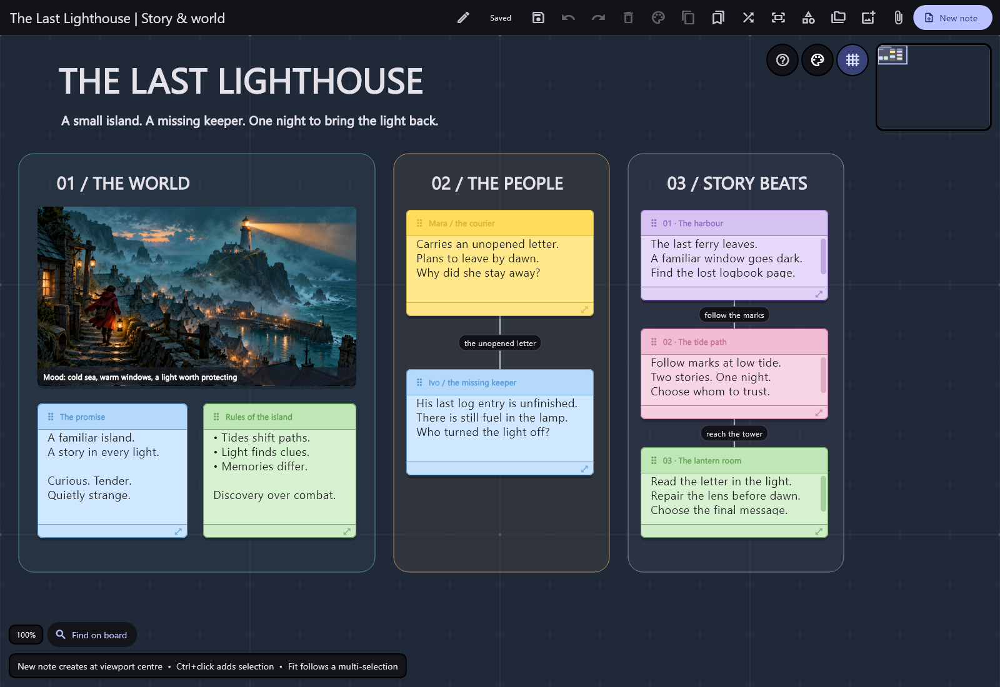
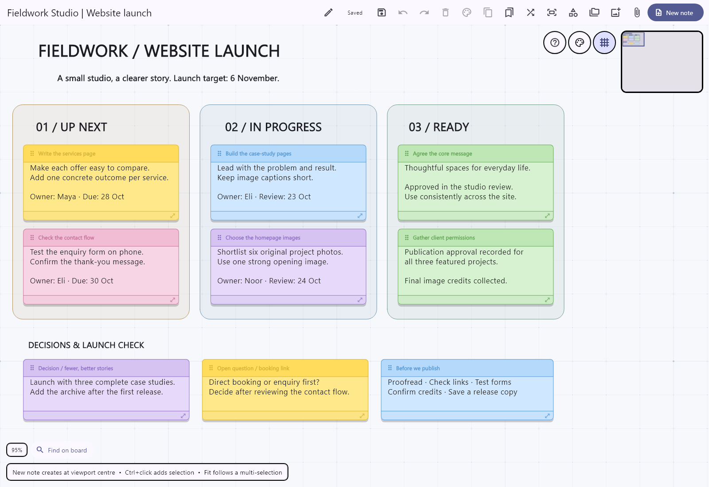

# Vasmim

Vasmim is a local-first visual thinking application for Windows, built with
Flutter. It combines freeform spatial planning, lightweight structure, and
managed reference material on spacious Boards, without an account or a cloud
service.





The Boards shown are fictional sample projects.

## Download

Get the Windows x64 ZIP from the
[Releases page](https://github.com/racasan/vasmim/releases). It is a portable
edition: extract the whole ZIP into a folder and run `vasmim.exe`. There is no
installer. Read [release/INSTALL.md](release/INSTALL.md) first; it covers the
Microsoft Visual C++ runtime prerequisite, the unsigned-publisher warning, and
where your Boards are stored.

## Licence and warranty

Vasmim is free. Its own source code is released under the
[BSD Zero Clause License](LICENSE): you may use, copy, modify, sell, and
redistribute it for any purpose, with no conditions and no attribution
required.

Vasmim is provided **as is**, without warranty of any kind. It is a personal
project. No support, updates, fixes, or data recovery are promised. Keep
independent backups of your Boards.

The libraries Vasmim depends on keep their own licences, so a compiled build is
not public-domain software as a whole. The Windows package lists them in
[release/THIRD_PARTY_NOTICES.md](release/THIRD_PARTY_NOTICES.md) and carries
their licence texts.

## What it does

### Think and arrange

- Start with a blank Board or an empty Kanban, Eisenhower, SWOT, or Campaign
  brief layout.
- Use Light or Dark mode, a per-Board paper tone, and a zoom-aware faint grid.
- Create and edit Notes, including optional titles, colour, emphasis, lists,
  and selected-text web links.
- Add Images, Canvas Headings, managed file Attachments, and YouTube cards.
- Connect Notes and Images with persistent labelled Connectors.
- Pan and zoom a fixed 6,000-by-4,500 Board, use marquee or mixed selection,
  recover misplaced content, and navigate with Overview and Zoom to Fit.
- Undo and redo Board changes, and copy and paste objects inside Vasmim.

### Organize without forcing a schema

- Save named Scenes, reorder or update them, and walk through them in order.
- Create flat persistent Groups with optional names, visibility, and a
  dedicated whole-group movement control.
- Draw background vector Shapes on ordered layers with visibility, Solo, and
  preset opacity: basic symbols, lines and arrows, block arrows, Flowchart
  Shapes, stars, banners, and callouts.
- Align movement to the visible grid and to neighbouring items with temporary
  guides, and lock items against accidental movement or resizing.

### Capture and find material

- Paste plain text, a website, a website list, or a Windows clipboard bitmap
  directly onto the Board.
- Import managed PNG, JPEG, and GIF images, and PDF, Word, Excel, movie, and
  audio references. PDFs open in a built-in reader. GIFs play on the Board
  when you choose Play. Audio, movies, and Office files open in the
  application Windows associates with them.
- Click a YouTube thumbnail to open the saved video in your browser.
- Find Notes, Images, labelled Connections, Scenes, and Shapes on the active
  Board or across the Library.

### Manage, transfer, and share

- Search, sort, favorite, preview, rename, duplicate, and file Boards in flat
  project folders from the Library.
- Export or import a self-contained `.vasmim` Board. Export all Boards with a
  manifest and verify a backup folder without importing it.
- Save the current view or the whole Board as a PNG, or copy it to the Windows
  clipboard as an image.
- Copy selections from one Board to another through the Library.

A fuller guide is in [docs/VASMIM_MANUAL.md](docs/VASMIM_MANUAL.md).

## Platform and data

- Windows x64 desktop only.
- Version `0.1.0-beta.2+3`; Board document format 31, with migrations from
  formats 1-30.
- Boards are stored below the Windows application-data directory as
  `boards/<board-id>/board.json` plus a Board-local `assets/` directory.
- Imported files are managed copies; Boards do not depend on the original
  source paths. Boards are not encrypted.
- No telemetry, analytics, or account. Some features make network requests
  (website icons, YouTube thumbnails); see
  [release/PRIVACY.md](release/PRIVACY.md).

Known limits are listed in
[release/KNOWN_LIMITATIONS.md](release/KNOWN_LIMITATIONS.md).

## Build from source

See [BUILDING.md](BUILDING.md). In short, with Flutter and the Visual Studio
C++ desktop tools installed:

```powershell
flutter pub get
flutter analyze
flutter test
flutter build windows
```

## Repository structure

- `lib/main.dart` - application bootstrap and production store wiring.
- `lib/board/` - Board model, persistence, migration, storage, and transfer.
- `lib/canvas/` - editor rendering, interaction, commands, and navigation.
- `lib/note/`, `lib/image/`, `lib/attachment/`, `lib/shape/`, and neighbours -
  the individual object types.
- `test/` - unit and widget tests mirroring the production areas.
- `windows/` - Windows runner and native integration, including the PDFium
  integrity pins.
- `release/` - the documents and third-party notices shipped in the Windows
  package.
- `tool/` - packaging and dependency-inventory scripts.

## Reporting problems

Use the [issue page](https://github.com/racasan/vasmim/issues); see
[release/BUG_REPORTING.md](release/BUG_REPORTING.md). Reports are welcome, but
no reply or fix is promised.

## How it was made

Vasmim was written by one person as a learning project, with substantial help
from AI coding assistants.
